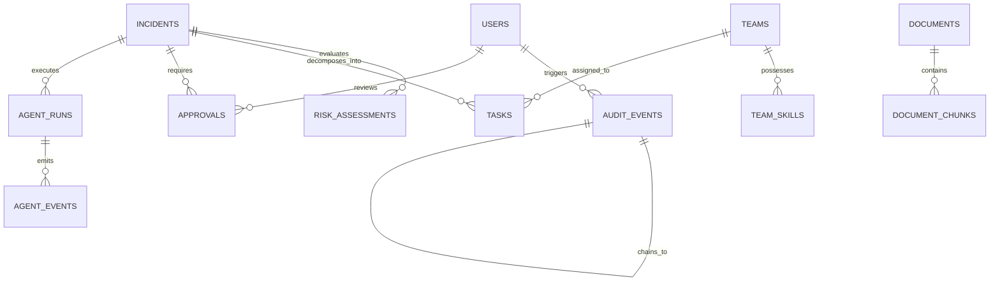

# InfraSphere AI — Database Schema Specification

## 1. Overview
The InfraSphere AI persistence layer combines a relational data store (managed via async SQLAlchemy with SQLite / PostgreSQL) and an embedded vector store (managed via Qdrant). All synthetic datasets are tagged explicitly with `is_synthetic: true`.

---

## 2. Relational Schema Architecture

---

## 3. Relational Tables Specification

### 3.1 `users`
System operators, administrators, and field analysts.
| Column | Type | Constraints | Description |
|---|---|---|---|
| `id` | VARCHAR(36) | PRIMARY KEY | UUID identifier |
| `email` | VARCHAR(255) | UNIQUE, NOT NULL | Operator login email |
| `password_hash` | VARCHAR(255) | NOT NULL | Bcrypt hashed password |
| `full_name` | VARCHAR(255) | NOT NULL | Operator display name |
| `role` | VARCHAR(50) | NOT NULL | `admin`, `manager`, `analyst` |
| `organization_id`| VARCHAR(100) | NULLABLE | Tenant / department ID |
| `is_active` | BOOLEAN | DEFAULT TRUE | Account active flag |
| `created_at` | DATETIME | NOT NULL | UTC creation timestamp |

### 3.2 `incidents`
Infrastructure failure reports across Bangladesh.
| Column | Type | Constraints | Description |
|---|---|---|---|
| `id` | VARCHAR(50) | PRIMARY KEY | Formatted ID (e.g. `INC-0041`) |
| `organization_id`| VARCHAR(100) | NULLABLE | Department ownership |
| `title` | VARCHAR(255) | NOT NULL | Summary title |
| `description` | TEXT | NOT NULL | Full report (English or Bangla) |
| `category` | VARCHAR(50) | NOT NULL | `flooding`, `bridge_damage`, `road_washout`, `drainage_block` |
| `severity` | VARCHAR(20) | NOT NULL | `low`, `medium`, `high`, `critical` |
| `status` | VARCHAR(30) | NOT NULL | `reported`, `investigating`, `pending_approval`, `approved`, `resolved` |
| `latitude` | FLOAT | NOT NULL | Coordinate latitude |
| `longitude` | FLOAT | NOT NULL | Coordinate longitude |
| `district` | VARCHAR(100) | NOT NULL | Bangladesh district (e.g. `Sunamganj`) |
| `language` | VARCHAR(10) | NOT NULL | Report language (`en`, `bn`) |
| `source` | VARCHAR(50) | NOT NULL | Source origin (e.g. `field_report`, `ffwc_telemetry`) |
| `is_synthetic` | BOOLEAN | DEFAULT TRUE | Synthetic data label |
| `created_by` | VARCHAR(36) | NULLABLE | User ID if manually created |
| `created_at` | DATETIME | NOT NULL | UTC creation timestamp |
| `updated_at` | DATETIME | NOT NULL | UTC update timestamp |

### 3.3 `station_observations`
River gauge telemetry observations from the Flood Forecasting and Warning Centre (FFWC).
| Column | Type | Constraints | Description |
|---|---|---|---|
| `id` | VARCHAR(50) | PRIMARY KEY | Formatted ID |
| `station_id` | VARCHAR(50) | NOT NULL | Official station code (e.g. `STN-SUN-01`) |
| `station_name` | VARCHAR(100) | NOT NULL | River station name |
| `district` | VARCHAR(100) | NOT NULL | Station district |
| `level` | FLOAT | NOT NULL | Current water level (meters) |
| `unit` | VARCHAR(10) | DEFAULT 'm' | Measurement unit |
| `danger_level` | FLOAT | NOT NULL | Station critical danger level |
| `recorded_at` | DATETIME | NOT NULL | Telemetry recording timestamp |
| `source` | VARCHAR(50) | DEFAULT 'ffwc' | Telemetry source |
| `is_synthetic` | BOOLEAN | DEFAULT TRUE | Synthetic benchmark label |

### 3.4 `risk_assessments`
Evaluated incident risk prioritization scores.
| Column | Type | Constraints | Description |
|---|---|---|---|
| `id` | VARCHAR(50) | PRIMARY KEY | Formatted ID (e.g. `RISK-XXXX`) |
| `incident_id` | VARCHAR(50) | FOREIGN KEY | Associated incident ID |
| `score` | FLOAT | NOT NULL | Composite risk score (0 - 100) |
| `risk_level` | VARCHAR(20) | NOT NULL | `low`, `medium`, `high`, `critical` |
| `model_version` | VARCHAR(50) | NOT NULL | Risk model algorithm version |
| `factors_json` | JSON | NOT NULL | Individual factor weights dictionary |
| `missing_factors_json`| JSON | NOT NULL | List of missing telemetry factors |
| `limitations_json` | JSON | NOT NULL | Model transparency disclosures |
| `created_at` | DATETIME | NOT NULL | UTC creation timestamp |

### 3.5 `documents` & `document_chunks`
Operational engineering guidelines, maintenance manuals, and historical reports.
| Table | Column | Type | Description |
|---|---|---|---|
| `documents` | `id` | VARCHAR(50) PK | Document code (e.g. `DOC-FLD-01`) |
| `documents` | `title` | VARCHAR(255) | Guideline document title |
| `documents` | `format` | VARCHAR(20) | File type (`markdown`, `pdf`, `txt`) |
| `documents` | `chunk_count`| INTEGER | Total chunk segments |
| `document_chunks`| `id` | VARCHAR(50) PK | Formatted chunk ID |
| `document_chunks`| `document_id`| VARCHAR(50) FK | Parent document reference |
| `document_chunks`| `chunk_index`| INTEGER | 0-indexed position |
| `document_chunks`| `page_number`| INTEGER | Source document page number |
| `document_chunks`| `content` | TEXT | Extracted chunk text |

### 3.6 `teams` & `team_skills`
Regional engineering and disaster response units.
| Table | Column | Type | Description |
|---|---|---|---|
| `teams` | `id` | VARCHAR(50) PK | Team code (e.g. `TEAM-SUN-01`) |
| `teams` | `name` | VARCHAR(255) | Unit name |
| `teams` | `district` | VARCHAR(100) | Home operating base |
| `teams` | `zone` | VARCHAR(50) | Division zone (`sylhet`, `chittagong`, etc.) |
| `teams` | `status` | VARCHAR(30) | `available`, `deployed`, `off_duty` |
| `team_skills`| `team_id` | VARCHAR(50) FK | Team association |
| `team_skills`| `skill` | VARCHAR(100) | Skill tag (`flood_response`, `structural_inspection`) |
| `team_skills`| `proficiency`| FLOAT | Proficiency rating (0.0 - 1.0) |

### 3.7 `tasks`
Decomposed operational DAG subtasks.
| Column | Type | Constraints | Description |
|---|---|---|---|
| `id` | VARCHAR(50) | PRIMARY KEY | Formatted ID (e.g. `TASK-XXXX`) |
| `incident_id` | VARCHAR(50) | FOREIGN KEY | Associated incident |
| `parent_task_id`| VARCHAR(50) | NULLABLE | Parent subtask reference |
| `title` | VARCHAR(255) | NOT NULL | Task title |
| `description` | TEXT | NOT NULL | Operational instructions |
| `priority` | VARCHAR(20) | NOT NULL | `low`, `medium`, `high`, `critical` |
| `status` | VARCHAR(30) | NOT NULL | `pending`, `in_progress`, `completed`, `blocked` |
| `assigned_team_id`| VARCHAR(50) | NULLABLE | Assigned response team |
| `dependencies` | JSON | NOT NULL | Array of required task IDs |
| `created_at` | DATETIME | NOT NULL | UTC creation timestamp |

### 3.8 `approvals`
Human-in-the-loop operational sign-offs.
| Column | Type | Constraints | Description |
|---|---|---|---|
| `id` | VARCHAR(50) | PRIMARY KEY | Formatted ID (e.g. `APR-XXXX`) |
| `incident_id` | VARCHAR(50) | FOREIGN KEY | Target incident ID |
| `recommendation_json` | JSON | NOT NULL | AI synthesized action plan |
| `reviewer_id` | VARCHAR(36) | NULLABLE | User ID of human approver |
| `status` | VARCHAR(30) | NOT NULL | `pending`, `approved`, `rejected`, `needs_revision` |
| `comment` | TEXT | NULLABLE | Mandatory reviewer audit rationale |
| `version` | INTEGER | DEFAULT 1 | Iteration version |
| `created_at` | DATETIME | NOT NULL | UTC creation timestamp |
| `reviewed_at` | DATETIME | NULLABLE | Decision timestamp |

### 3.9 `audit_events`
Cryptographically chained immutable ledger.
| Column | Type | Constraints | Description |
|---|---|---|---|
| `id` | VARCHAR(36) | PRIMARY KEY | UUID identifier |
| `actor` | VARCHAR(255) | NOT NULL | User ID, agent ID, or system component |
| `event_type` | VARCHAR(100) | NOT NULL | Type of action audited |
| `entity_type`| VARCHAR(50) | NOT NULL | Object class (`approval`, `incident`, `security`) |
| `entity_id` | VARCHAR(100) | NOT NULL | Target entity identifier |
| `previous_hash`| VARCHAR(64) | NOT NULL | SHA-256 hash of preceding event ($H_{i-1}$) |
| `event_hash` | VARCHAR(64) | NOT NULL | Computed hash of this event ($H_i$) |
| `payload_json` | JSON | NOT NULL | Deterministic payload content |
| `created_at` | DATETIME | NOT NULL | UTC event timestamp |

---

## 4. Vector Database Schema (Qdrant)

The Knowledge Grid maintains an embedded Qdrant vector collection: `knowledge_chunks`.
- **Vector Dimensions:** 384 (or 1024 depending on embedding model)
- **Distance Metric:** Cosine Similarity
- **Payload Indexing:**
  - `document_id` (Keyword)
  - `page_number` (Integer)
  - `title` (Text)
  - `content` (Fulltext search enabled)
  - `is_synthetic` (Boolean)
