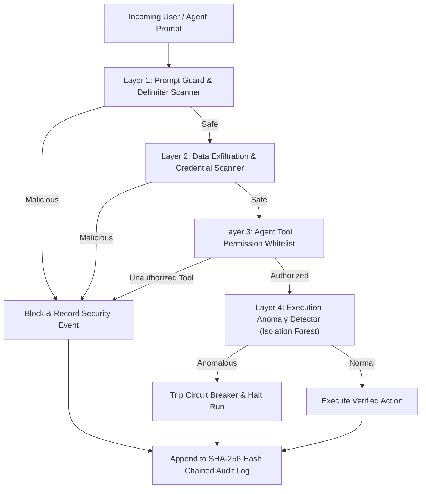

# InfraSphere AI — Security Model & Threat Mitigation Matrix

## 1. Security Architecture Principles

Operating autonomous AI systems in critical public infrastructure demands defense-in-depth. InfraSphere AI adheres to three foundational tenets:
1. **Zero Implicit Trust:** All inputs (whether from public citizen portals, field staff, or internal LLM inter-agent messages) are treated as untrusted and inspected prior to processing.
2. **Strict Least Privilege (Bounded Agency):** No AI agent possesses system-level execution authority. Agents cannot write arbitrary database queries, invoke unauthorized APIs, or autonomously dispatch physical resources without certified human approval.
3. **Cryptographic Accountability:** All security events and operational actions are permanently committed to an immutable SHA-256 hash-chained ledger.

---

## 2. Threat Mitigation Matrix (OWASP LLM Top 10)

| Vulnerability Code | OWASP Threat Description | InfraSphere AI Mitigation Strategy | Verification / Implementation |
|---|---|---|---|
| **LLM01** | **Prompt Injection** | Layered prompt inspection combines regex pattern matching for instruction override delimiters (`ignore previous`, `disregard`, `system:`) with heuristic scoring. | `backend/app/secureai/prompt_guard.py` (Evaluated at 100% precision on benchmark suite). |
| **LLM02** | **Insecure Output Handling** | Structured output parsing via Pydantic schemas. Tool inputs and state machine transitions reject raw, unvalidated LLM output strings. | Schema validation across all agent runners. |
| **LLM06** | **Sensitive Information Disclosure** | Data exfiltration filter intercepts requests for database dumps, passwords, API tokens, and credentials. Redacts PII before processing. | `secureai/prompt_guard.py` (`DATA_EXFILTRATION_PATTERNS`). |
| **LLM07** | **Insecure Plugin / Tool Design** | Static tool whitelisting restricts each agent role strictly to read-only queries or designated analytical functions. System mutations are blocked. | `secureai/tool_policy.py` (`AGENT_TOOL_POLICIES`). |
| **LLM08** | **Excessive Agency** | High-impact actions (road closures, team deployments, official alerts) mandate human sign-off via the Human+AI Governance Center. | `human_ai/approval_service.py` state machine. |
| **LLM10** | **Unbounded Consumption / Runaway Execution** | Automatic Circuit Breaker monitors execution steps, execution duration, and detects repetitive duplicate calls. | `agentops/circuit_breaker.py` (Trips on >10 steps or >60s). |

---

## 3. Defense-in-Depth Pipeline

---

## 4. Cryptographic Hash-Chain Mathematics

To guarantee that logs cannot be altered, forged, or back-dated by rogue actors or system administrators, InfraSphere AI implements an append-only SHA-256 cryptographic chain.

### Hash Equation:
$$H_0 = \text{"0"}^{64} \quad (\text{Genesis Hash})$$
$$H_i = \text{SHA256}\left(H_{i-1} \parallel \text{CanonicalJSON}(E_i)\right)$$

Where:
- $H_i$ is the cryptographic hash of audit event $i$.
- $H_{i-1}$ is the stored `previous_hash`.
- $\text{CanonicalJSON}(E_i)$ serializes keys in sorted order with deterministic whitespace:
  $$\text{CanonicalJSON}(E) = \text{json.dumps}(E, \text{sort\_keys}=\text{True}, \text{separators}=(\text{','}, \text{':'}), \text{default}=\text{str})$$

### Verification Algorithm:
1. Fetch all audit events sorted chronologically by `created_at ASC`.
2. Initialize expected pointer $\hat{H} = H_0$.
3. For each event $e_i$:
   - Verify that $e_i.\text{previous\_hash} == \hat{H}$.
   - Recompute $\hat{H}_{\text{computed}} = \text{SHA256}(\hat{H} \parallel \text{CanonicalJSON}(e_i))$.
   - Verify that $\hat{H}_{\text{computed}} == e_i.\text{event\_hash}$.
   - Advance expected pointer $\hat{H} = e_i.\text{event\_hash}$.
4. If any assertion fails, record the index of the first broken link and raise a tampering alert.

This algorithm is verified in `backend/tests/test_audit.py` and available via the 1-click verification tool in the command center.
