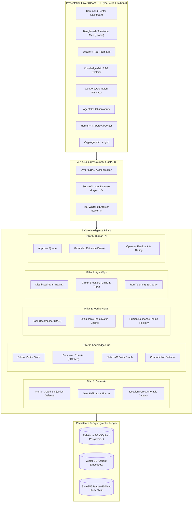

# InfraSphere AI — System Architecture Specification

## 1. Executive Summary & Product Vision

**InfraSphere AI** is a modular-monolith intelligent operations platform designed for trusted, transparent, and audited multi-agent collaboration in high-stakes infrastructure environments. 

Demonstrated through its flagship deployment, **InfraOps BD** (Bangladesh Infrastructure Intelligence & Response Platform), InfraSphere AI coordinates AI agents, enterprise operational documents, human response teams, and security controls through a unified command center.

### Core Problems Addressed:
1. **Scattered Operational Knowledge:** Structural blueprints, flood response SOPs, and historical incident logs exist across siloed systems.
2. **Unsafe & Uncontrolled Agent Agency:** Unconstrained AI agents can take destructive actions (e.g. autonomous road closures or database writes) without verification.
3. **Black-Box Decision Making:** Lack of explainable calculations for risk scoring, team allocation, and threat classification.
4. **Untraceable Operations:** Auditing gaps where neither AI reasoning nor human intervention can be cryptographically verified.
5. **Disconnected Human Governance:** Human operators are relegated to passive spectators rather than authoritative governors.

---

## 2. High-Level Architecture: Modular Monolith

To maximize development velocity, maintain zero networking overhead, and guarantee atomic transactions during a 48-hour build, InfraSphere AI is architected as an **internally decoupled modular monolith**. Each pillar maintains clean software boundaries, allowing future extraction into dedicated microservices if distributed scale is demanded.

---

## 3. The Five Pillars in Detail

### Pillar 1: SecureAI (Defense-in-Depth)
SecureAI acts as the protective perimeter around the entire platform:
- **Layer 1: Prompt Guard & Injection Detector:** Multi-stage defense combining regex pattern matchers, heuristic signatures, and semantic keywords to block prompt overrides, role-playing jailbreaks (e.g. DAN attacks), and delimiter escapes.
- **Layer 2: Data Exfiltration Blocker:** Intercepts requests attempting to leak secrets, API keys, credentials, or dump raw user databases.
- **Layer 3: Strict Tool Permission Whitelisting:** Enforces role-based permissions per agent. Agents are restricted strictly to read-only queries or designated analytical tools. Autonomous system mutations or arbitrary command execution are unconditionally denied.
- **Layer 4: Execution Anomaly Detection:** An unsupervised `IsolationForest` model trained on operational telemetry (step counts, execution latencies, repeated tool calls) paired with hard limit thresholds.
- **Layer 5: Tamper-Evident Security Auditing:** Any blocked attack or flagged input triggers an immutable audit log entry.

### Pillar 2: Knowledge Grid (Grounded RAG)
Knowledge Grid eliminates hallucination by strictly grounding recommendations in verified documentation:
- **Ingestion & Chunking:** Ingests engineering SOPs, maintenance guides, and flood guidelines (PDF, Markdown, TXT) using sliding chunking with header and metadata preservation.
- **Hybrid Embeddings:** Utilizes a dual embedding strategy supporting sentence transformers (`bge-m3`, `triBne-e5-small`) and a deterministic mock embedding provider for 100% offline reliability.
- **Dense Vector Search:** High-performance similarity search powered by Qdrant.
- **Strict Citation & Abstention:** Every factual claim in generated operational answers must cite its exact source document and page number (e.g. `[DOC-FLD-01 p.1]`). When an answer is not present in the ingested corpus, the system strictly abstains rather than inventing answers.
- **Contradiction Detection:** Cross-checks claims across historical reports and updated SOPs to identify conflicting status records on infrastructure assets.
- **Relational Knowledge Graph:** Employs NetworkX to map connections between Incidents, Infrastructure Assets, River Basins, and Response Teams.

### Pillar 3: WorkforceOS (Human-Agent Teaming)
WorkforceOS orchestrates the division of labor between AI agents and human teams:
- **Task Decomposition:** Decomposes complex infrastructure emergencies into directed acyclic graph (DAG) subtasks with explicit prerequisite dependencies.
- **Explainable Match Scoring:** Evaluates candidate response teams using a transparent, multi-factor linear equation:
  $$\text{Score} = 0.40 \cdot \text{Skill} + 0.25 \cdot \text{Zone} + 0.20 \cdot \text{Availability} + 0.15 \cdot \text{Workload}$$
- **Human Response Teams Registry:** Tracks physical regional teams across Bangladesh (Sylhet, Sunamganj, Chittagong, Dhaka) along with their verified skills (dewatering, structural inspection, road clearance, emergency medical).

### Pillar 4: AgentOps (Observability & Reliability)
AgentOps provides visibility into autonomous workflows and guards against runaway failures:
- **Execution Lifecycle Management:** Every agent invocation generates an `AgentRun` record tracking status transitions (`pending`, `running`, `completed`, `failed`, `tripped`).
- **Distributed Span Tracing:** Fine-grained `TraceSpan` records log granular timings for prompt evaluation, vector lookups, risk computation, and output parsing.
- **Automatic Circuit Breakers:** Protects the platform against infinite loops, recursive tool invocations, and runaway resource consumption. Triggers an open circuit breaker when:
  - Step count exceeds 10 steps.
  - Duration exceeds 60 seconds.
  - 3 duplicate tool calls are executed consecutively.
- **Manual Overrides:** Operators can manually trip or reset circuit breakers from the dashboard.

### Pillar 5: Human+AI (Accountable Governance)
Human+AI enforces the core philosophical mandate: **AI proposes, human authorizes**.
- **Human-in-the-Loop Approval Queue:** Critical operational recommendations (dispatching maintenance crews, closing arterial highways, issuing public flood advisories) cannot be executed autonomously. They are placed in an approval queue awaiting certified human review.
- **Evidence Drawer:** Reviewers are presented with a consolidated dossier including grounded document citations, FFWC river gauge readings, risk factor weights, and proposed team assignments.
- **Three-Way Decision State:** Operators can **Approve**, **Reject**, or **Request Revision** with mandatory recorded rationale.
- **RLHF & Feedback Loop:** Operators submit structured evaluations (Helpful / Unhelpful + qualitative feedback) to guide continuous prompt and model alignment.

---

## 4. Tamper-Evident Cryptographic Audit Ledger

All security violations, operational recommendations, and human authorizations are recorded in an append-only cryptographic ledger using SHA-256 hash chaining:

$$H_i = \text{SHA256}\left(H_{i-1} \parallel \text{CanonicalJSON}(E_i)\right)$$

Where:
- $H_0 = 0^{64}$ (64 zeroes genesis hash).
- $H_{i-1}$ is the cryptographic hash of the preceding event.
- $\text{CanonicalJSON}(E_i)$ is the deterministic, sorted-key serialization of event $i$.

The frontend provides a one-click verification tool that validates the complete cryptographic chain from genesis to the latest head in real time.

---

## 5. Technology Stack Summary

| Layer | Component | Choice | Justification |
|---|---|---|---|
| **Frontend** | Framework | React 19 + TypeScript + Vite | Maximum reactivity, fast HMR, type safety |
| **Frontend** | Styling | Tailwind CSS v4 | Clean command-center UI, responsive design |
| **Frontend** | Mapping | Leaflet | Lightweight, zero-dependency Bangladesh situational map |
| **Backend** | API Engine | FastAPI (Python 3.13) | Native async support, automatic OpenAPI docs |
| **Backend** | ORM | SQLAlchemy 2.0 (Async) | Declarative data models with async sessions |
| **Backend** | Relational DB | SQLite (async via aiosqlite) | Zero external server overhead; PostgreSQL compatible |
| **Backend** | Vector DB | Qdrant Client (In-memory/Local) | High performance dense vector similarity search |
| **Backend** | Machine Learning | Scikit-learn | Fast, CPU-friendly TF-IDF, LinearSVC, Isolation Forest |
| **Backend** | Knowledge Graph| NetworkX | In-memory entity and relationship graph analysis |
| **Security** | Auth & Hashes | Bcrypt + Python-JOSE | Industry-standard password hashing and JWT tokens |
